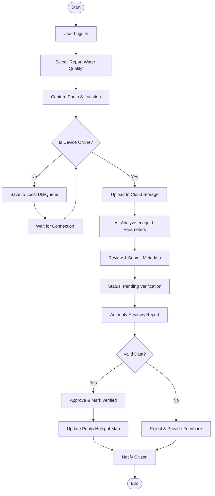

# AquaWatch: Activity Diagram

This diagram illustrates the operational flow of the AquaWatch system, specifically focusing on the lifecycle of a water quality report.

## Core Process: Water Quality Reporting & Verification

The activity diagram below shows the interaction between the Citizen (User), the Automated AI System, and the Authority (Admin).

## Key Activity Nodes Explained:
*   **Capture Photo & Location**: The system automatically pulls GPS data while the user takes a photo of the water source.
*   **Offline Queue**: If no internet is detected, the report is cached locally to prevent data loss.
*   **AI Analysis**: The system performs initial processing (pH/TDS estimation) before the user even hits submit, providing immediate (though unverified) feedback.
*   **Authority Review**: A human-in-the-loop step ensures the crowdsourced data is accurate before it becomes public on the hotspot map.
*   **Map Update**: Only verified reports contribute to the global water quality visualization.
