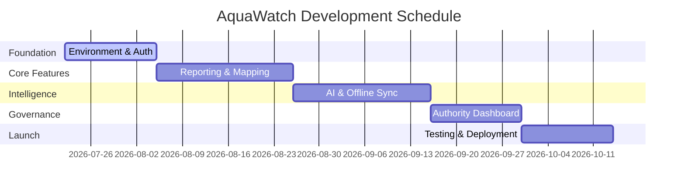

# AquaWatch: Project Scheduling

This schedule breaks down the 12-week development cycle into specific milestones and deliverables.

## Week 1-2: Initiation & Foundation
*   **Milestone 1**: Project kickoff and environment setup.
*   **Deliverables**:
    *   Firebase project configuration.
    *   Authentication module (Email/Google).
    *   Core data models (Submission, User, Authority).

## Week 3-5: Core Development (Citizen Features)
*   **Milestone 2**: Functional reporting workflow.
*   **Deliverables**:
    *   Camera & Gallery integration.
    *   GPS/Geocoding automation.
    *   Interactive Map View with clustering.

## Week 6-8: Advanced Logic (Intelligence)
*   **Milestone 3**: AI Integration & Sync Reliability.
*   **Deliverables**:
    *   AI Parameter Estimation engine.
    *   Offline Local Database (SQLite/Hive).
    *   Background Sync service.

## Week 9-10: Authority & Verification
*   **Milestone 4**: Governance Dashboard.
*   **Deliverables**:
    *   Authority Verification UI.
    *   Status Notification system.
    *   Data Analytics export (CSV/PDF).

## Week 11-12: Optimization & Launch
*   **Milestone 5**: Production Readiness.
*   **Deliverables**:
    *   Final Bug Fixing & Performance tuning.
    *   UAT with target user groups.
    *   Store Submission (Play Store/App Store).

---

## Gantt Chart Preview (High-Level)

