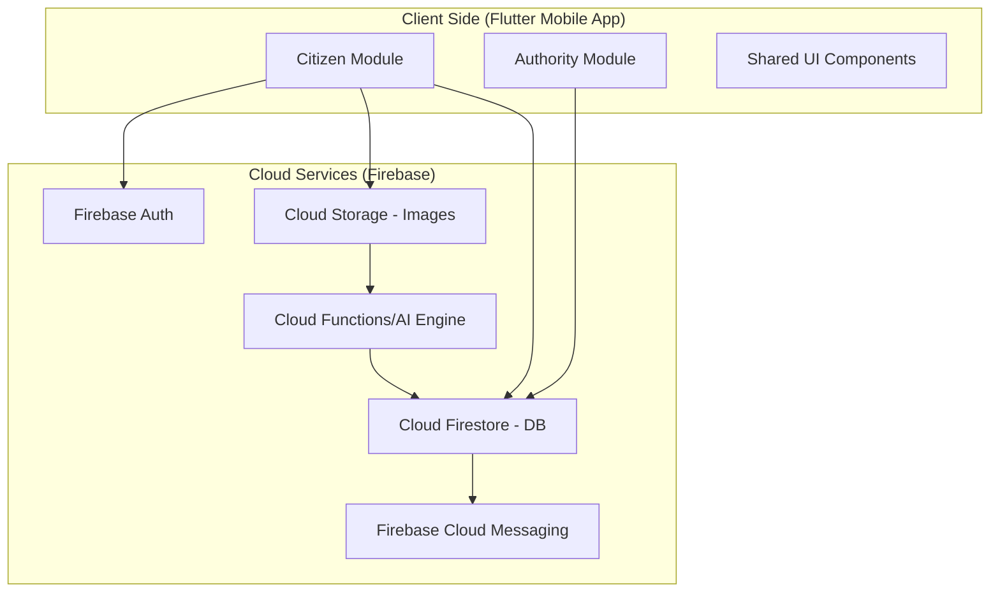
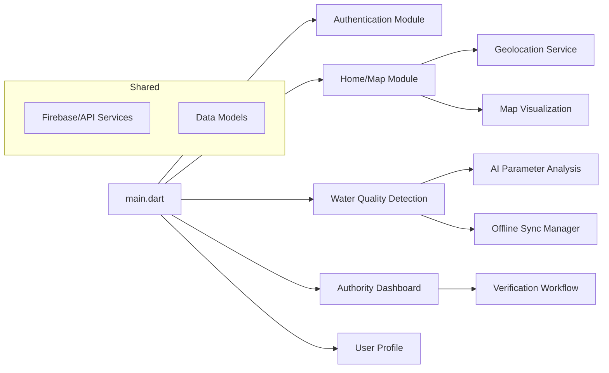
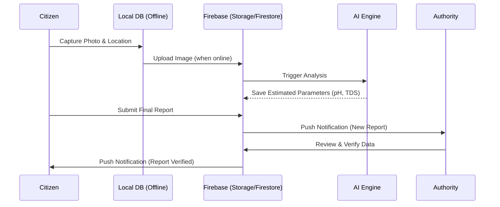
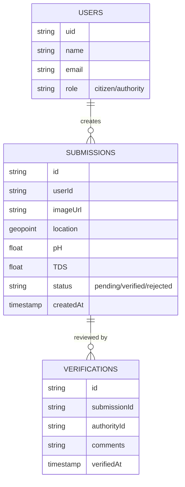

# AquaWatch: System Design

This document outlines the technical architecture, component breakdown, and data flow of the AquaWatch platform.

## 1. High-Level Architecture
AquaWatch follows a standard **Client-Cloud** architecture, leveraging Flutter for cross-platform mobile development and Firebase for backend-as-a-service.

## 2. Component Diagram
The internal structure of the Flutter application is modularized by feature.

## 3. Data Flow: Report Submission & Verification
This sequence shows the lifecycle of a water quality report from creation to verification.

## 4. Database Schema (Firestore Collections)
A simplified view of the primary data entities.

## 5. Modular Architecture (MVVM Pattern)
The application uses the Model-View-ViewModel (MVVM) pattern to separate concerns and ensure testability.

*   **View Layer**: Flutter Widgets responsible for the UI. They observe ViewModels for state changes.
*   **ViewModel Layer**: Holds the business logic and UI state. It interacts with Repositories to fetch/save data.
*   **Model Layer**: Data entities and business logic models.
*   **Data/Repository Layer**: Handles data source abstraction (Firebase vs. Local Cache).

## 6. Security & Data Integrity
*   **Firebase Security Rules**: Granular access control for Firestore and Storage.
    *   *Citizen*: Can write to their own submissions; can read only verified reports on the public map.
    *   *Authority*: Can read all submissions and write to verification sub-collections.
*   **Authentication**: Multi-factor authentication support via Firebase Auth.
*   **Data Validation**: Strict schema validation via Cloud Functions before final persistence.

## 7. AI Service Integration
*   **Workflow**: Images uploaded to Cloud Storage trigger a Firebase Cloud Function.
*   **Processing**: The function interacts with an AI analysis engine (e.g., Gemini or a custom model) to estimate water parameters.
*   **Persistence**: Results are written directly back to the specific Submission document in Firestore for user review.

## 8. Offline-First Strategy
*   **Local Caching**: Submissions are initially saved to a local SQLite/Hive database.
*   **Synchronization**: A background worker (WorkManager/Cron) monitors connectivity and pushes pending reports to Firebase when online.
*   **Consistency**: Conflict resolution logic ensures that local edits do not overwrite server-verified data.
