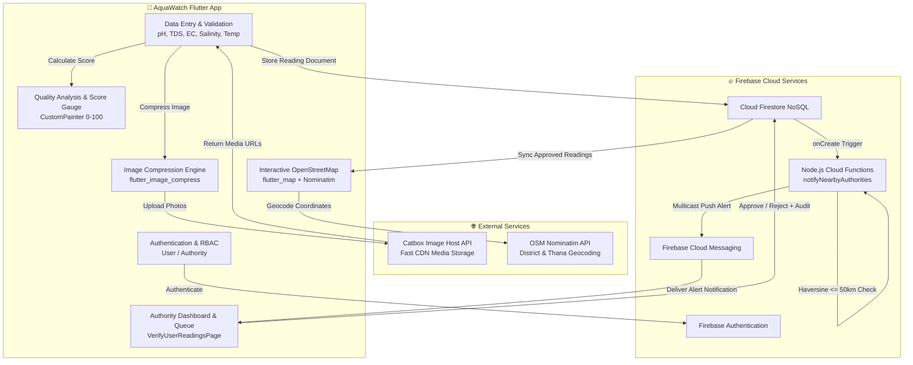
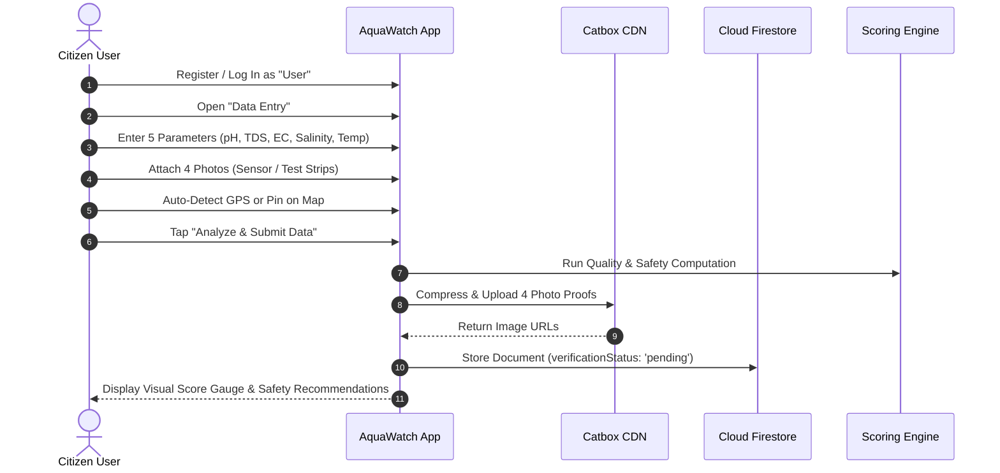
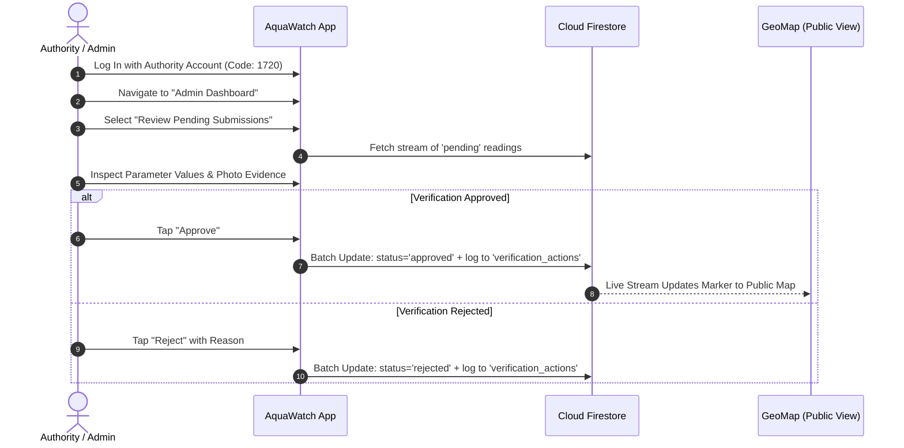

# 🌊 AquaWatch — Smart Water Quality Monitoring & Verification Platform

[](https://flutter.dev)
[](https://dart.dev)
[](https://firebase.google.com)
[](https://www.openstreetmap.org)
[](#-system-requirements)
[](LICENSE)

**AquaWatch** is a comprehensive, community-driven mobile and cloud ecosystem designed to democratize water quality surveillance. The platform empowers citizens to report localized water quality metrics with photographic proof, leverages an automated parameter scoring engine, and connects directly to environmental authorities through geofenced push alerts and an administrative verification portal.

---

## 📑 Table of Contents

- [Key Highlights & Features](#-key-highlights--features)
- [System Architecture](#-system-architecture)
- [Water Quality Analysis Engine](#-water-quality-analysis-engine)
- [Geospatial & Spatial Notification System](#-geospatial--spatial-notification-system)
- [Database Schema (Cloud Firestore)](#-database-schema-cloud-firestore)
- [Project Directory Structure](#-project-directory-structure)
- [Prerequisites & System Requirements](#-prerequisites--system-requirements)
- [Installation & Local Setup](#-installation--local-setup)
- [Firebase & Cloud Functions Configuration](#-firebase--cloud-functions-configuration)
- [Running & Building the App](#-running--building-the-app)
- [Role-Based Workflows & User Guides](#-role-based-workflows--user-guides)
- [Troubleshooting & FAQs](#-troubleshooting--faqs)
- [Contributing & License](#-contributing--license)

---

## ✨ Key Highlights & Features

### 👤 Citizen & Contributor Features
- **Multi-Parameter Submission**: Enter 5 critical water parameters (`pH`, `TDS`, `EC`, `Salinity`, `Temperature`).
- **Photographic Evidence Upload**: Attach mandatory photo evidence for test strips / sensor readings across parameters.
- **Client-Side Image Optimization**: Automatic image compression (`flutter_image_compress`) reducing payload size to `< 250 KB` before upload, ensuring high performance over low-bandwidth cellular networks.
- **Dual Location Capture**: High-accuracy automatic GPS location acquisition via `geolocator` or interactive map-based manual coordinate pin placement.
- **Real-Time Quality Assessment**: Instant quality scoring (0–100) with visual half-circle gauges, color-coded status badges, and contextual usage recommendations (drinking, irrigation, recreation).
- **Interactive Public Map (`GeoMap`)**: OpenStreetMap-powered map with real-time Firestore synchronization displaying only verified water stations, with search and category filtering (`All`, `Excellent`, `Good`, `Fair`, `Poor`, `Unsafe`).

### 🛡️ Authority & Administrator Features
- **Role-Based Access Control (RBAC)**: Secure role segregation (`User` vs `Authority`) with security verification passcodes (Default: `1720`).
- **Live Admin Dashboard**: Real-time aggregated statistics via reactive streams (`StreamZip`) tracking Total Users, Pending Review, Approved, and Rejected readings alongside queue health alerts.
- **Submission Verification Queue**: Comprehensive review interface allowing inspectors to examine parameter values, verify uploaded photographic proof, and approve or reject submissions with logged reasons.
- **Audit Logging**: Every verification decision records an immutable trace in `verification_actions` capturing inspector details, action timestamp, and rationale.
- **Spatial Monitoring Map**: Dynamic radius filtering (1 km – 30 km) to inspect contamination clusters and visualize safe vs unsafe water points around a specific center point.
- **Bangladesh Administrative Geocoding & Radius Search**: Built-in hierarchy of all 64 Bangladesh districts and thanas/upazilas with rate-limited OpenStreetMap Nominatim geocoding and Haversine distance spatial queries.

### ⚡ Cloud & Automation Backend
- **Automated Geofenced Alerting**: Firebase Cloud Function (`notifyNearbyAuthorities`) triggers on new readings, calculates distances via the Haversine formula, and multicasts FCM push notifications to all authorities within a **50 km radius**.
- **Notification Delivery Auditing**: Logs dispatch results, authority count, and delivery metrics to `notification_logs`.

---

## 🏛️ System Architecture



---

## 🧪 Water Quality Analysis Engine

AquaWatch incorporates an algorithmic assessment engine based on World Health Organization (WHO) and Bangladesh Drinking Water Standards:

| Parameter | Unit | Safe / Ideal Range | Acceptable Range | Poor / Dangerous Range | Health & Environmental Impact |
| :--- | :---: | :---: | :---: | :---: | :--- |
| **pH Level** | pH | `6.5 – 8.5` | `6.0 – 6.5` / `8.5 – 9.0` | `< 6.0` (Acidic) / `> 9.0` (Alkaline) | Corrosion of pipes, bitter taste, mucous membrane irritation. |
| **TDS** | ppm (mg/L) | `0 – 300` (Excellent)<br/>`301 – 500` (Good) | `501 – 900` (Fair) | `901 – 1200` (Poor)<br/>`> 1200` (Unsafe) | High mineral concentration, potential toxic ion presence, scaling. |
| **EC** | µS/cm | `0 – 800` | `801 – 1500` | `1501 – 2000` (Poor)<br/>`> 2000` (Dangerous) | Indicator of total dissolved electrolytes, industrial runoff, or salinity. |
| **Salinity** | ppt (g/L) | `0 – 0.5` (Fresh) | `0.6 – 1.0` (Marginal)<br/>`1.1 – 5.0` (Brackish) | `5.1 – 30.0` (Saline)<br/>`> 30.0` (Seawater level) | Unsuitable for human consumption and agricultural irrigation. |
| **Temperature**| °C | `20 – 25` | `15 – 20` / `25 – 30` | `< 15` or `> 30` (Suboptimal)<br/>`> 35` (Extreme) | Influences dissolved oxygen solubility and biological bacterial kinetics. |

### Overall Score Computation
1. Each parameter $i$ receives a normalized fractional score $s_i \in [0.1, 1.0]$.
2. The overall composite score is computed as the arithmetic mean:
   $$\text{Score} = \text{round}\left( \frac{1}{N}\sum_{i=1}^{N} s_i \times 100 \right)$$
3. The overall quality tier is bounded by the **worst-performing parameter** to prevent dangerous anomalies from being masked by average metrics:
   - 🟢 **Excellent** (Score $\ge 85$, all parameters within safe limits)
   - 🟢 **Good** (Score $70 - 84$, parameters within acceptable limits)
   - 🟠 **Fair / Acceptable** (Score $50 - 69$, filtration/treatment recommended)
   - 🔴 **Poor** (Score $30 - 49$, treatment strongly recommended)
   - ⛔ **Unsafe / Dangerous** (Score $< 30$, hazardous for consumption)

---

## 📍 Geospatial & Spatial Notification System

### 1. Haversine Distance Formulation
Both the Flutter client (`PlaceRepository`, `AdminMonitoringMapPage`) and the Cloud Functions backend calculate great-circle distances over the WGS84 ellipsoid using the Haversine formula:

$$d = 2R \arcsin\left(\sqrt{\sin^2\left(\frac{\Delta \phi}{2}\right) + \cos(\phi_1)\cos(\phi_2)\sin^2\left(\frac{\Delta \lambda}{2}\right)}\right)$$

Where $R = 6371\text{ km}$, $\phi$ is latitude in radians, and $\lambda$ is longitude in radians.

### 2. Automated Authority Dispatch (Cloud Functions)
When a citizen submits a water report:
1. `functions.firestore.document('water_quality_readings/{readingId}').onCreate` triggers.
2. The function queries all users with `role == 'Authority'` possessing a registered coordinate and FCM token.
3. Computes distance $d$ from the submission coordinate to each authority's coordinate.
4. For all authorities where $d \le 50\text{ km}$, batches tokens (up to 500 per batch) and invokes `admin.messaging().sendEachForMulticast()`.
5. Logs results in `notification_logs`.

---

## 🗄️ Database Schema (Cloud Firestore)

### Collection: `users`
```json
{
  "name": "John Doe",
  "email": "john@example.com",
  "phone": "+8801700000000",
  "address": "Dhanmondi, Dhaka",
  "role": "User", // or "Authority"
  "location": {
    "latitude": 23.7465,
    "longitude": 90.3760,
    "address": "Road 27, Dhanmondi",
    "city": "Dhaka",
    "country": "Bangladesh"
  },
  "fcmToken": "eK3x...fcmTokenString",
  "fcmTokenUpdatedAt": "Timestamp",
  "createdAt": "Timestamp"
}
```

### Collection: `water_quality_readings`
```json
{
  "userId": "firebase_auth_uid_123",
  "ph": 7.2,
  "tds": 240.0,
  "ec": 450.0,
  "salinity": 0.2,
  "temperature": 24.5,
  "latitude": 23.8103,
  "longitude": 90.4125,
  "phImageUrls": ["https://files.catbox.moe/xxxxxx.jpg"],
  "tdsImageUrls": ["https://files.catbox.moe/yyyyyy.jpg"],
  "ecImageUrls": ["https://files.catbox.moe/zzzzzz.jpg"],
  "salinityImageUrls": ["https://files.catbox.moe/aaaaaa.jpg"],
  "overallQuality": "Excellent",
  "overallScore": 92,
  "overallSummary": "All parameters are within excellent range...",
  "parameterResults": [
    {
      "name": "pH Level",
      "unit": "pH",
      "value": 7.2,
      "safeRange": "6.5 – 8.5",
      "level": "Excellent",
      "remark": "pH is within the safe drinking water range.",
      "score": 1.0
    }
  ],
  "verificationStatus": "pending", // "pending" | "approved" | "rejected"
  "submittedAt": "Timestamp",
  "verifiedAt": "Timestamp" // populated upon approval
}
```

### Collection: `verification_actions`
```json
{
  "submissionId": "reading_document_id",
  "userId": "submitter_user_id",
  "verifierUid": "authority_user_id",
  "verifierName": "Inspector Jane",
  "verifierEmail": "jane@authority.gov",
  "action": "approved", // "approved" | "rejected"
  "reason": "Photo evidence confirms readings.",
  "actionDate": "Timestamp"
}
```

### Collection: `notification_logs`
```json
{
  "readingId": "reading_document_id",
  "submittedBy": "user_uid",
  "submitterName": "John Doe",
  "submissionLocation": {
    "latitude": 23.8103,
    "longitude": 90.4125
  },
  "radiusKm": 50,
  "authoritiesNotified": 3,
  "successfulNotifications": 3,
  "failedNotifications": 0,
  "createdAt": "Timestamp"
}
```

---

## 📁 Project Directory Structure

```text
aquawatch/
├── android/                         # Android native configurations & gradle files
│   ├── app/
│   │   ├── build.gradle.kts         # Kotlin DSL Android app gradle configuration
│   │   ├── google-services.json     # Firebase Android services config
│   │   └── src/main/AndroidManifest.xml # Permissions (Camera, GPS, Internet, Storage)
├── functions/                       # Firebase Cloud Functions (Backend)
│   ├── src/
│   │   └── index.ts                 # Haversine calculation, geofenced FCM alerts, token RPCs
│   ├── package.json                 # Node.js dependencies
│   └── tsconfig.json                # TypeScript compiler configuration
├── ios/                             # iOS native configurations
│   ├── Runner/
│   │   ├── Info.plist               # iOS permissions & location/camera descriptions
│   │   └── GoogleService-Info.plist # Firebase iOS services config
├── lib/                             # Core Flutter application source
│   ├── main.dart                    # App entry point, background messaging, splash gate
│   ├── authentication/              # Auth flow & location onboarding
│   │   ├── forgot_pass.dart         # Password recovery screen
│   │   ├── location_selection_dialog.dart # Auto-GPS / Manual Bangladesh district selection
│   │   ├── login.dart               # User & Authority login screen
│   │   └── register.dart            # Registration with role toggle & passcode validation
│   ├── authority/                   # Admin & Inspector management suite
│   │   ├── admin_dashboard_page.dart # Real-time metrics stream & queue health monitor
│   │   ├── admin_monitoring_map_page.dart # Dynamic spatial radius circle map inspector
│   │   ├── bangladesh_area_data.dart# Complete 64 Bangladesh districts & thanas dataset
│   │   ├── district_thana_place_search_page.dart # Geocoding & place radius search
│   │   └── verify_user_readings_page.dart # Review queue, photo verification & approval
│   ├── home/                        # Citizen landing hub
│   │   └── home.dart                # Role-aware dashboard, navigation cards, header badge
│   ├── profile/                     # User profile management
│   │   └── profile_page.dart        # Profile details, coordinates, role display & logout
│   ├── services/                    # Business logic & infrastructure services
│   │   ├── auth_service.dart        # Firebase Auth wrapper & error handler
│   │   ├── geocoding_service.dart   # Nominatim API geocoding with 1s rate limiting
│   │   ├── location_service.dart    # Geolocator & reverse geocoding placemark helper
│   │   ├── notification_service.dart# FCM token registration & foreground message handler
│   │   ├── place_repository.dart    # Haversine-based place radius search repository
│   │   ├── reading_verification_service.dart # Approval/rejection batch transactions
│   │   └── water_reading_service.dart# Catbox image upload & Firestore submission logic
│   └── visualize_data/              # Public data visualization
│       └── geo_map.dart             # Real-time OpenStreetMap with verified station markers
│   └── water_quality_detection/     # Measurement & scoring engine
│       ├── data_analysis_report.dart# Score gauge, parameter breakdown & advice
│       └── data_entry.dart          # Parameter input form, photo picker & GPS capture
├── test/                            # Unit & widget tests
├── pubspec.yaml                     # Flutter package dependencies & assets
└── README.md                        # Documentation & setup guide
```

---

## 📋 Prerequisites & System Requirements

### Development Environment
- **Operating System**: Windows 10/11, macOS 12+, or Ubuntu 20.04+
- **Flutter SDK**: `^3.10.1` or higher ([Flutter Install Guide](https://docs.flutter.dev/get-started/install))
- **Dart SDK**: `^3.10.1` (bundled with Flutter)
- **Node.js**: `v18.x` or `v20.x` (for Firebase Cloud Functions)
- **Java Development Kit (JDK)**: JDK 17 (recommended for Android Gradle builds)
- **Git**: `v2.20+`

### Target Device Requirements
- **Android**: Android 7.0 (API level 24) or higher
- **iOS**: iOS 12.0 or higher

---

## 🚀 Installation & Local Setup

### 1. Clone the Repository
```bash
git clone https://github.com/sayedulmorsalin/AquaWatch.git
cd AquaWatch
```

### 2. Install Flutter Dependencies
```bash
flutter pub get
```

### 3. Verify Environment Configuration
Run `flutter doctor` to ensure all toolchains are properly configured:
```bash
flutter doctor -v
```

---

## 🔥 Firebase & Cloud Functions Configuration

### 1. Firebase Project Creation
1. Go to the [Firebase Console](https://console.firebase.google.com/) and create a new project named `AquaWatch`.
2. Enable **Authentication** (Email/Password provider).
3. Enable **Cloud Firestore** (start in production or test mode with appropriate security rules).
4. Enable **Firebase Cloud Messaging (FCM)**.

### 2. Configure Android App in Firebase
1. Register Android App with package name: `com.example.aquawatch` (or your custom `applicationId` in `android/app/build.gradle.kts`).
2. Download `google-services.json` and place it in:
   ```text
   aquawatch/android/app/google-services.json
   ```

### 3. Configure iOS App in Firebase (Optional for iOS builds)
1. Register iOS App with Bundle ID: `com.example.aquawatch`.
2. Download `GoogleService-Info.plist` and place it in:
   ```text
   aquawatch/ios/Runner/GoogleService-Info.plist
   ```

### 4. Deploy Cloud Functions
1. Install Firebase CLI globally:
   ```bash
   npm install -g firebase-tools
   ```
2. Log in and initialize Firebase in the project root:
   ```bash
   firebase login
   firebase use --add <your-firebase-project-id>
   ```
3. Install Cloud Function dependencies and compile TypeScript:
   ```bash
   cd functions
   npm install
   npm run build
   ```
4. Deploy the functions to Firebase:
   ```bash
   firebase deploy --only functions
   ```

---

## 📱 Running & Building the App

### Running in Debug Mode

#### On Android Device / Emulator:
```bash
# Check connected devices
flutter devices

# Run the app
flutter run
```

#### On iOS Simulator / Device (macOS only):
```bash
flutter run -d ios
```

#### On Web (Chrome):
```bash
flutter run -d chrome
```

---

### Building for Production

#### Generate Android APK & App Bundle:
```bash
# Build optimized release APK
flutter build apk --release

# Output path: build/app/outputs/flutter-apk/app-release.apk

# Build Android App Bundle for Google Play
flutter build appbundle --release

# Output path: build/app/outputs/bundle/release/app-release.aab
```

#### Generate iOS Release Build:
```bash
flutter build ios --release
```

---

## 👥 Role-Based Workflows & User Guides

### 💧 1. Citizen Workflow


### 🛡️ 2. Authority Verification Workflow


---

## ⚙️ Security Rules & Permissions

### Android Permissions (`AndroidManifest.xml`)
The following permissions are configured in `android/app/src/main/AndroidManifest.xml`:
- `android.permission.INTERNET` — Network communication for Firebase, Catbox, and OpenStreetMap tiles.
- `android.permission.ACCESS_FINE_LOCATION` — Accurate GPS coordinate capture for water samples.
- `android.permission.ACCESS_COARSE_LOCATION` — Network-based location fallback.
- `android.permission.CAMERA` — Capturing live photo evidence of testing equipment.
- `android.permission.READ_EXTERNAL_STORAGE` / `READ_MEDIA_IMAGES` — Image picker gallery selection.

### Recommended Firestore Security Rules
```javascript
rules_version = '2';
service cloud.firestore {
  match /databases/{database}/documents {
    
    // User profile documents
    match /users/{userId} {
      allow read: if request.auth != null;
      allow write: if request.auth != null && request.auth.uid == userId;
    }
    
    // Water quality readings
    match /water_quality_readings/{readingId} {
      allow read: if true; // Public can read approved stations
      allow create: if request.auth != null;
      allow update, delete: if request.auth != null && 
        (get(/databases/$(database)/documents/users/$(request.auth.uid)).data.role == 'Authority' ||
         get(/databases/$(database)/documents/users/$(request.auth.uid)).data.role == 'Admin');
    }
    
    // Audit logs for verification actions
    match /verification_actions/{actionId} {
      allow read, write: if request.auth != null && 
        (get(/databases/$(database)/documents/users/$(request.auth.uid)).data.role == 'Authority' ||
         get(/databases/$(database)/documents/users/$(request.auth.uid)).data.role == 'Admin');
    }
    
    // Logs for notifications
    match /notification_logs/{logId} {
      allow read, write: if request.auth != null;
    }
  }
}
```

---

## ❓ Troubleshooting & FAQs

### Q1: Why are my newly submitted readings not appearing on the Water Map?
> **Answer**: By design, submissions start with a `verificationStatus` of `'pending'`. Only readings that have been officially verified and approved by an Authority through the **Admin Dashboard** appear on the public `GeoMap`.

### Q2: How can I register as an Authority for testing?
> **Answer**: On the Registration screen, switch the user role toggle to **Authority**. When prompted, enter the authority registration security code: `1720`.

### Q3: Location capture fails or times out.
> **Answer**:
> 1. Ensure Location/GPS is turned ON on your physical device or emulator.
> 2. On Android emulators, ensure coordinates are set in the emulator Extended Controls (`...` → Location).
> 3. You can switch to **Manual Mode** in the app to search by Bangladesh District/Thana or place a pin on the map.

### Q4: OpenStreetMap tiles are not loading.
> **Answer**: Check your internet connection. AquaWatch sets an application `User-Agent` header (`AquaWatch/1.0`) complying with the OpenStreetMap and Nominatim Fair Use policies.

---

## 🤝 Contributing

Contributions make the open-source community an inspiring place to learn, inspire, and create. Any contributions you make are **greatly appreciated**.

1. Fork the Project
2. Create your Feature Branch (`git checkout -b feature/AmazingFeature`)
3. Commit your Changes (`git commit -m 'Add some AmazingFeature'`)
4. Push to the Branch (`git push origin feature/AmazingFeature`)
5. Open a Pull Request

---

## 📄 License

Distributed under the **MIT License**. See `LICENSE` for more information.

---

<p align="center">
  Built with 💙 by <a href="https://github.com/sayedulmorsalin">Sayedul Morsalin</a> & the AquaWatch Community
</p>
